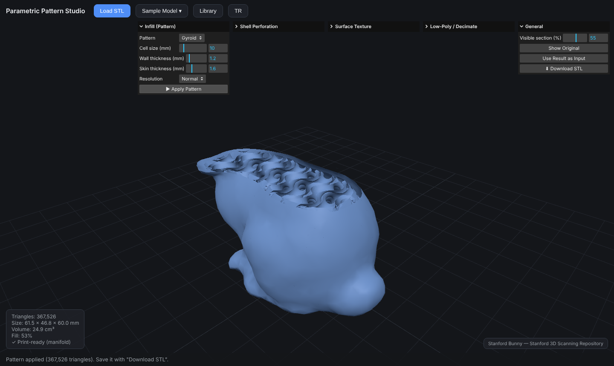

# Parametric Pattern Studio

**Live:** https://ekagansahin.github.io/parametric-pattern-studio/



*Free browser-based studio for 3D-printable patterns: gyroid/TPMS infill, Voronoi shell perforation, organic surface textures (reaction-diffusion) and low-poly decimation for STL files — 100% client-side, print-ready output.*

Upload an STL → apply a pattern → download a print-ready STL. Runs entirely in the browser — no server, your data never leaves your device.
Four modes: **infill** (Gyroid, Schwarz P, Voronoi foam), **shell perforation** (Voronoi shell, Delaunay wireframe), **surface texture** (noise/wave/honeycomb/reaction-diffusion), and **low-poly decimation**. English and Turkish interface.

## Running locally

```bash
npm install
npm run dev
```

Open the address printed in the terminal (usually http://localhost:5173) in your browser.

## Usage

1. Pick a model with "Load STL" (or choose Knot / Stanford Bunny / 3DBenchy / Stanford Dragon from the "Sample Model" menu, or drag and drop a file).
2. Open the relevant panel from the independent panels in the top right and adjust the parameters. In the Infill panel:
   - **Cell size:** the gyroid cell's period in mm (smaller = denser pattern).
   - **Wall thickness:** thickness of the gyroid walls (≥0.8 mm recommended for typical nozzles).
   - **Skin thickness:** solid layer left on the model's outer surface (0 = no skin, pattern exposed).
   - **Resolution:** Draft for a fast preview, High for final output.
3. "▶ Apply Pattern" → look inside with the "Visible section" slider in the General panel (100% = fully visible).
4. "⬇ Download STL".

### Shell Perforation

From the "Shell Perforation" panel, choose **Voronoi shell** (organic perforated shell) or **Delaunay wireframe**. **Hole size** sets the diameter of the cells/holes, **strut thickness** sets the beams in between, and **shell thickness** sets the depth of the perforated layer. The result is always manifold; check the "✓ Print-ready (manifold)" line in the stats panel.

### Surface Texture

Pick a texture from the "Surface Texture" panel: Noise (organic), Wave, Hexagon (honeycomb), or Reaction-Diffusion (Spots/Maze/Coral — self-organizing patterns like living organisms). **Scale** sets the pattern size, **Depth** sets the relief height (peak-to-valley, mm). "Auto-densify mesh" refines the mesh on low-poly models so the texture is visible. The texture is applied to whichever model is currently shown — it can also be layered on top of a pattern output.

### Low-Poly / Decimation

From the "Low-Poly / Decimate" panel, enter a triangle ratio (%) or a target triangle count directly — the two are linked, changing one updates the other — then press "▶ Simplify". "Flat shading" shows off the low-poly look. Also used to shrink large STLs before applying a pattern: simplify → "Use Result as Input" → apply pattern.

### Library

Every STL you download (result + original) is stored only on your device, in the browser's IndexedDB. Use the "Library" button in the top bar to re-download past work, reload it into the app with "Load", or delete it. Duplicates are skipped automatically; if the 250MB limit is exceeded, the oldest items are removed.

## Tests

```bash
npm test        # geometry pipeline tests (Node)
npm run build   # production build (GitHub Pages compatible, base: './')
```

Run by section: `TEST_SECTIONS=core|textures|shell|step7|library npm test` (comma-separated for multiple).

## Architecture (overview)

- `src/pipeline.js` — pattern catalog (SDF) + manifold-3d pipeline (pure, testable)
- `src/shellcut.js` — shell perforation: surface sampling + Voronoi/Delaunay SDF
- `src/textures.js` — surface texture engine (displacement + reaction-diffusion)
- `src/simplify.js` — low-poly (meshoptimizer) + ratio↔target sync
- `src/worker.js` — runs the pipeline in a Web Worker (keeps the UI responsive)
- `src/stl.js` — dependency-free STL read/write
- `src/viewer.js` + `src/clip.js` — Three.js scene + clipping plane
- `src/library.js` — on-device library (IndexedDB: downloaded STLs + originals)
- `src/main.js` — UI and state management (independent panels)
- `src/i18n.js` — English and Turkish interface strings
- `public/models/` — sample models (Stanford Bunny/Dragon, 3DBenchy; attribution in the UI)

## Deployment

Every push to `main` runs tests + build via GitHub Actions and automatically publishes to GitHub Pages (`.github/workflows/deploy.yml`). In the repo settings, Pages → Source must be set to "GitHub Actions".

## License

The code is **MIT** licensed © 2026 Eyup Kağan Şahin (see [LICENSE](LICENSE)). The sample models in `public/models/` are not covered by the code's license — see [NOTICE.md](NOTICE.md):

- **Stanford Bunny / Dragon** (`bunny.stl`, `dragon.stl`) — derived from the Stanford 3D Scanning Repository; free to use with attribution.
- **#3DBenchy** (`benchy.stl`) — © CreativeTools.se, CC BY-ND 4.0, distributed unmodified. https://www.3dbenchy.com
